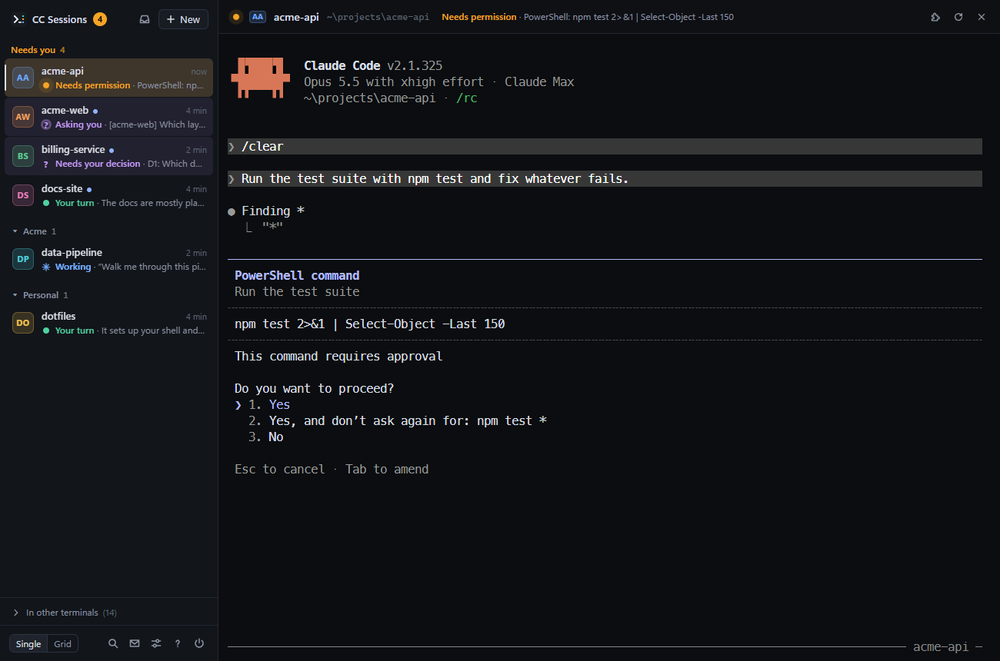
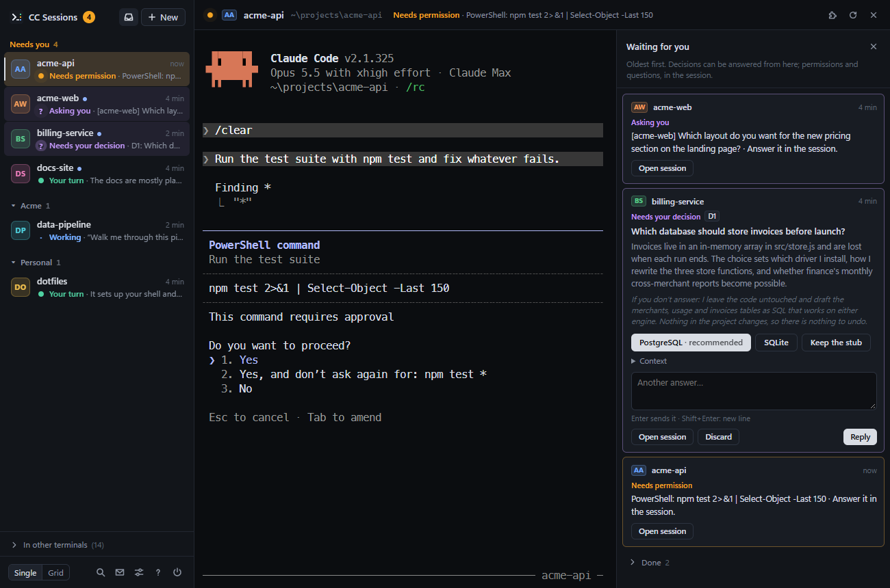
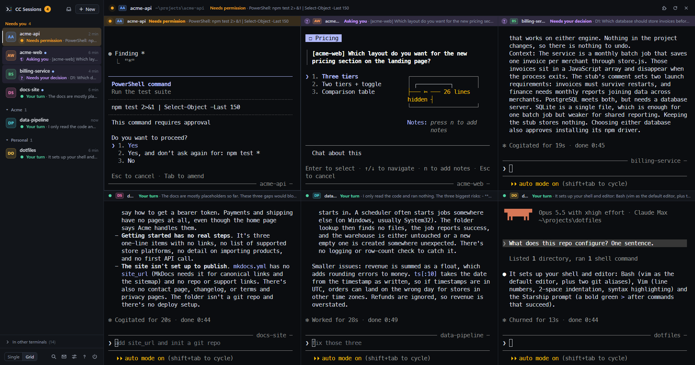

# CC Sessions

[English](README.md) · **Español**

**Todas tus sesiones de Claude Code en una ventana y, de un vistazo, las que te necesitan.**

Con varios agentes de Claude Code a la vez, lo difícil es saber cuál te espera: un permiso en una terminal, una pregunta en otra, un turno terminado en una tercera. CC Sessions ejecuta cada sesión en una terminal real y sigue cada una en directo con los hooks de Claude Code. Las que te necesitan suben arriba, con el comando o la pregunta concretos.



> Proyecto no oficial, sin relación con Anthropic. «Claude» y «Claude Code» son marcas de Anthropic.

## Lo mejor

- **Estado en vivo de cada sesión.** Trabajando, Necesita permiso (con el comando), Te pregunta (con la pregunta), Necesita tu decisión, Tu turno. Las que te necesitan suben arriba. Con la ventana en segundo plano te llega además una notificación de Windows y parpadea la barra de tareas.
- **Una bandeja con todo lo que espera de ti** (`Ctrl+Shift+I`). Permisos, preguntas y decisiones, de la más antigua a la más nueva, cada una con cuánto lleva esperando y su contexto. Las tarjetas de decisión traen un botón por opción, y un clic escribe la respuesta en la sesión. Las sesiones las plantean con la herramienta `ask_user` de la app, o como tarjeta en su mensaje.
- **Sigues donde lo dejaste.** Las sesiones, los grupos, la vista y la posición de la ventana se guardan continuamente. Al volver a abrir, cada conversación se retoma con `claude --resume`, y una sesión cortada a mitad de turno ofrece el botón «Pedir que continúe».
- **Pensada para muchas sesiones.** Vista individual o en cuadrícula, grupos, insignias de color, buscador rápido (`Ctrl+Shift+K`), «ir a la siguiente que me necesita» (`Ctrl+Shift+J`) y las sesiones que tienes abiertas en otras terminales.
- **Mensajes entre sesiones.** Un panel muestra lo que tus agentes se dicen con `SendMessage` y si ya lo han leído. Necesita Claude Code 2.1.234 o posterior.
- **Reinicios seguros.** Antes de reiniciar la app, se pide a cada sesión que pare sus tareas en segundo plano y deje su trabajo listo para retomarlo. Al volver, a cada una se le dice que continúe.
- **Recordatorios que sobreviven a los reinicios.** Una sesión puede programarse un recordatorio con la herramienta `schedule_reminder` de la app. La app lo guarda aunque se reinicien la app o la sesión, y se lo entrega cuando está libre, marcado como atrasado si a esa hora la app estaba cerrada.
- **Un buzón de alertas para tareas del sistema.** Las tareas que se ejecutan como administrador o SYSTEM pueden dejar avisos de formato fijo en una carpeta en la que solo ellas escriben, y la app se los pasa a una sesión para que los revise, comprobados, con un límite de frecuencia y marcados como que no vienen de ti.
- **Plugins por sesión.** Activa un plugin como Playwright en una sola sesión. La propia sesión también puede pedirlo, con el servidor MCP que trae la app.
- **Sesiones de administrador, con cuidado.** Las sesiones elevadas pasan por un pequeño auxiliar instalado en una carpeta solo para administradores, comprobado fichero a fichero contra un manifiesto SHA-256. La app nunca eleva código que tu usuario pueda cambiar.
- **¿No estás delante del PC?** Si hay sesiones que llevan demasiado esperando mientras estás fuera, la app puede ejecutar un comando de tu elección (por ejemplo, uno que te mande un mensaje al móvil).
- **No toca tu configuración.** Tu `~/.claude/settings.json` no se modifica: cada sesión recibe los hooks de la app en su propio fichero `--settings`.





## Instalar

Necesitas Windows 11, [Node.js](https://nodejs.org/) 20 o superior, [Git](https://git-scm.com/) y [Claude Code](https://docs.claude.com/en/docs/claude-code).

Si te faltan Node.js o Git, puedes instalar los dos desde PowerShell y abrir después una ventana nueva para que estén en el PATH:

```powershell
winget install -e --id OpenJS.NodeJS.LTS --source winget
winget install -e --id Git.Git --source winget
```

Después:

```powershell
git clone https://github.com/moictab/cc-sessions.git
cd cc-sessions
npm install
npm start
```

Si npm avisa de que no ha ejecutado los scripts de instalación de `node-pty`, puedes ignorarlo: `node-pty` trae binarios ya hechos para Windows y la app los carga tal cual.

El primer arranque añade **CC Sessions** al menú Inicio; desde entonces se abre desde ahí. La interfaz está en inglés o en español (Ajustes → Interfaz → Idioma).

Para actualizar, cierra la app y ejecuta `git pull` y `npm install`. Tus sesiones y ajustes viven en `%APPDATA%\cc-sessions`, así que se conservan al actualizar. [La guía](docs/guia.md#instalar) explica cómo desinstalar y el auxiliar de administrador.

## Tarjetas de decisión

Pide a tus sesiones que terminen el turno con una tarjeta cuando necesiten que decidas algo. La app convierte cada tarjeta en una entrada de la bandeja, con un botón por opción. Añade esto a tu `CLAUDE.md`:

```markdown
## Cuando necesites una decisión mía
Termina el mensaje con una tarjeta que se entienda sola, en texto llano:

[tu-proyecto] Necesito tu decisión: <la pregunta, o un resumen si son varias>

D1. <la pregunta, en una línea>
Resumen: <unas 50 palabras: qué se decide y qué cambia según la respuesta>
Opciones: Sí (recomendada) | No
Si no contestas: <qué harás mientras, y si se puede deshacer>
Contexto: <unos párrafos para alguien que no ha seguido la conversación>

Como mucho tres decisiones por mensaje, numeradas D1, D2… Contestaré «D1: sí».
Cuando cambie lo que esperas de mí, añade un bloque «Pendiente de ti:»
con una línea por cosa («- D1: …»).
```

También valen en inglés (`I need your decision`, `Waiting on you`).

Dentro de CC Sessions, las sesiones pueden saltarse el formato de texto: el servidor MCP de la app les da la herramienta `ask_user`, que pone la misma tarjeta en la bandeja a partir de datos estructurados y comprobados, y `resolve_decision`, para retirarla. Las sesiones de fuera de la app y las de administrador siguen con la tarjeta. Para que prefieran la herramienta, añade al texto de arriba una línea como esta:

```markdown
Si tienes el servidor MCP cc-sessions, plantea la decisión con su herramienta ask_user en vez de escribir la tarjeta, y nómbrala en una línea de tu mensaje.
```

## Cómo funciona

- **Terminales:** Electron, [xterm.js](https://xtermjs.org/) con su renderizado WebGL y [node-pty](https://github.com/microsoft/node-pty) sobre ConPTY de Windows.
- **Estado:** cada sesión se lanza con su propio fichero `--settings`, que añade hooks (`SessionStart`, `UserPromptSubmit`, `PreToolUse`, `PostToolUse`, `Notification`, `Stop`). Los hooks informan a un servidor HTTP en `127.0.0.1`, con puerto aleatorio y un token por arranque.
- **Respaldo:** el registro de sesiones de Claude Code (`~/.claude/sessions`) corrige los hooks perdidos y muestra las sesiones abiertas fuera de la app.
- **Bandeja:** un pequeño analizador lee las tarjetas de decisión del último mensaje de cada turno. Para los turnos que terminaron con la app cerrada, las busca en la transcripción.
- **Servidor MCP:** el mismo servidor local da a las sesiones herramientas propias de la app: `ask_user` y `resolve_decision` para la bandeja, `schedule_reminder` (con `list_reminders` y `cancel_reminder`) y `set_plugin`.

La [guía completa](docs/guia.md) explica cada función, todos los atajos y cómo funciona por dentro, incluido el modelo de seguridad del auxiliar de administrador.

## Limitaciones

- Restaurar retoma la *conversación*, no el trabajo a medias: lo que una sesión estaba ejecutando al cerrarse la app hay que volver a lanzarlo.
- Solo se ha probado en Windows 11.
- La app se apoya en algunos formatos internos de Claude Code (el registro de sesiones y los mensajes entre sesiones), que pueden cambiar sin aviso.

## Licencia

[MIT](LICENSE)
