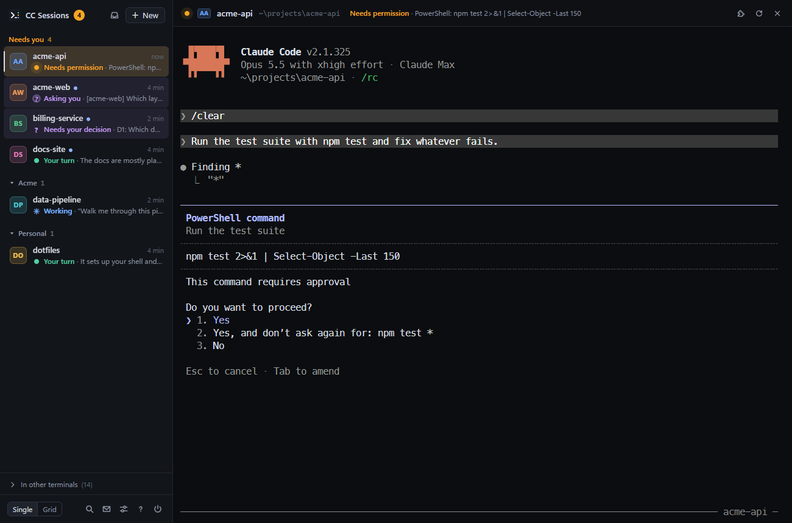
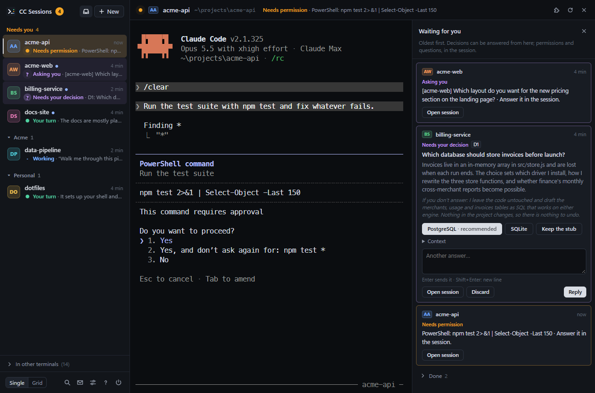
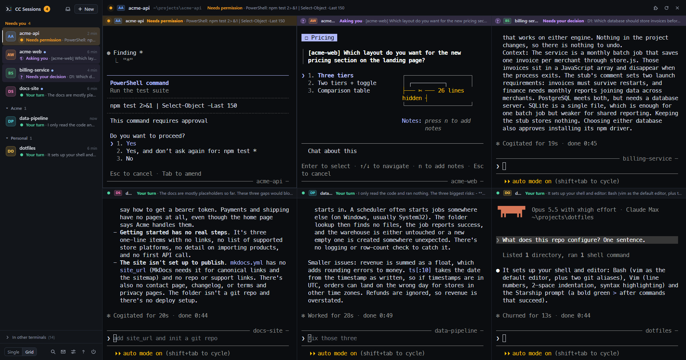

# CC Sessions

**English** · [Español](README.es.md)

**One window for all your Claude Code sessions, and at a glance, the ones that need you.**

When you run several Claude Code agents at once, most of the work is noticing which one is waiting: a permission prompt in one terminal, a question in another, a finished turn in a third. CC Sessions runs every session in a real terminal, follows each one live through Claude Code's hooks, and puts the ones that need you on top, with the exact command or question.



> Unofficial project, not affiliated with Anthropic. "Claude" and "Claude Code" are trademarks of Anthropic.

## Highlights

- **Live status for every session.** Working, Needs permission (with the command), Asking you (with the question), Needs your decision, Your turn. Sessions that need you jump to the top. When the window is in the background you also get a Windows notification and a flashing taskbar button.
- **One inbox for everything waiting on you** (`Ctrl+Shift+I`). Permissions, questions and decisions, oldest first, each with how long it has waited and its context. Decision cards come with one button per option, and a click types the answer into the session. Sessions raise them with the app's `ask_user` tool, or as a card in their message.
- **Pick up where you left off.** Sessions, groups, layout and window position are saved continuously. On the next start every conversation resumes with `claude --resume`, and a session cut off mid-turn gets an "Ask it to continue" button.
- **Built for many sessions.** Single or grid view, groups, colored badges, a quick switcher (`Ctrl+Shift+K`), "go to the next one that needs me" (`Ctrl+Shift+J`), and the sessions you have open in other terminals.
- **Messages between sessions.** A panel shows what your agents tell each other with `SendMessage`, and whether it has been read.
- **Safe restarts.** Before the app restarts, every session is asked to stop its background tasks and leave its work resumable. When they're back, each one is told to carry on.
- **Reminders that survive restarts.** A session can set itself a reminder with the app's `schedule_reminder` tool. The app keeps it across restarts of the app and of the session, and hands it over when the session is free, marked as late if the app was closed at the time.
- **An alert inbox for system tasks.** Tasks running as administrator or SYSTEM can leave fixed-format notices in a folder only they can write to, and the app hands them to one session to look into, checked, rate-limited and labeled as not coming from you.
- **Per-session plugins.** Turn a plugin like Playwright on in one session only. A session can also ask for it itself, through the app's built-in MCP server.
- **Administrator sessions, done carefully.** Elevated sessions run through a small helper installed in an admin-only folder, checked file by file against a SHA-256 manifest. The app never elevates code your user account could change.
- **Away from the PC?** If sessions wait too long while you're away, the app can run a command of your choice (for example, one that sends a message to your phone).
- **Leaves your setup alone.** Your `~/.claude/settings.json` is never modified: each session gets the app's hooks through its own `--settings` file.





## Install

You need Windows 11, [Node.js](https://nodejs.org/) 20 or later, [Git](https://git-scm.com/) and [Claude Code](https://docs.claude.com/en/docs/claude-code).

If you're missing Node.js or Git, you can install both from PowerShell, then open a new window so they're on the PATH:

```powershell
winget install -e --id OpenJS.NodeJS.LTS --source winget
winget install -e --id Git.Git --source winget
```

Then:

```powershell
git clone https://github.com/moictab/cc-sessions.git
cd cc-sessions
npm install
npm start
```

The first start adds **CC Sessions** to the Start menu; from then on, open it from there. The interface is in English or Spanish (Settings → Interface → Language).

To update, close the app and run `git pull` and `npm install`. Your sessions and settings live in `%APPDATA%\cc-sessions`, so updates keep them. [The guide](docs/guide.md#install) covers uninstalling and the administrator helper.

## Decision cards

Ask your sessions to end a turn with a card when they need you to decide something. The app turns each card into an inbox entry with a button per option. Add this to your `CLAUDE.md`:

```markdown
## When you need a decision from me
End your message with a card that makes sense on its own, in plain text:

[your-project] I need your decision: <the question, or a summary if there are several>

D1. <the question, on one line>
Summary: <about 50 words: what is being decided and what changes with each answer>
Options: Yes (recommended) | No
If you don't answer: <what you'll do meanwhile, and whether it can be undone>
Context: <a few paragraphs for someone who hasn't followed the conversation>

At most three decisions per message, numbered D1, D2… I'll answer "D1: yes".
When the list of things you're waiting on changes, add a "Waiting on you:" block
with one line per item ("- D1: …").
```

Cards in Spanish work too (`Necesito tu decisión`, `Pendiente de ti`).

Inside CC Sessions, sessions can skip the text format: the app's MCP server gives them an `ask_user` tool that puts the same card in the inbox from checked, structured data, and a `resolve_decision` tool to take one off. Sessions outside the app, and administrator sessions, keep using the card. To have them prefer the tool, add a line like this to the snippet above:

```markdown
If you have the cc-sessions MCP server, raise the decision with its ask_user tool instead of writing the card, and name it in one line of your message.
```

## How it works

- **Terminals:** Electron, [xterm.js](https://xtermjs.org/) with its WebGL renderer, and [node-pty](https://github.com/microsoft/node-pty) on Windows ConPTY.
- **Status:** each session is launched with its own `--settings` file that adds hooks (`SessionStart`, `UserPromptSubmit`, `PreToolUse`, `PostToolUse`, `Notification`, `Stop`). The hooks report to an HTTP server on `127.0.0.1`, on a random port and with a per-run token.
- **Fallback:** Claude Code's session registry (`~/.claude/sessions`) corrects missed hooks and shows sessions running outside the app.
- **Inbox:** a small parser reads decision cards out of each turn's last message, and out of the transcript for turns that ended while the app was closed.
- **MCP server:** the same local server gives sessions the app's own tools: `ask_user` and `resolve_decision` for the inbox, `schedule_reminder` (with `list_reminders` and `cancel_reminder`), and `set_plugin`.

The [full guide](docs/guide.md) covers every feature, every shortcut and the internals, including the administrator helper's security model.

## Limitations

- Restoring resumes the *conversation*, not work in progress: anything a session was running when the app closed has to be started again.
- Tested on Windows 11 only.
- The app relies on some internal Claude Code formats (the session registry and cross-session messages), which may change without notice.

## License

[MIT](LICENSE)
